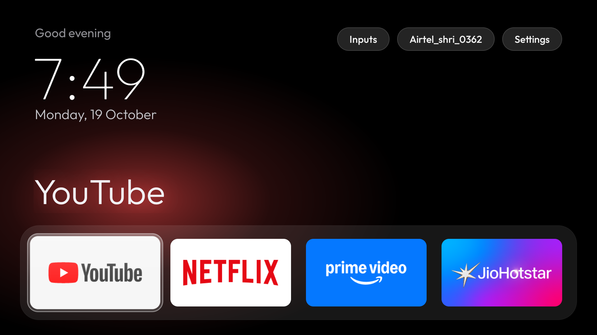
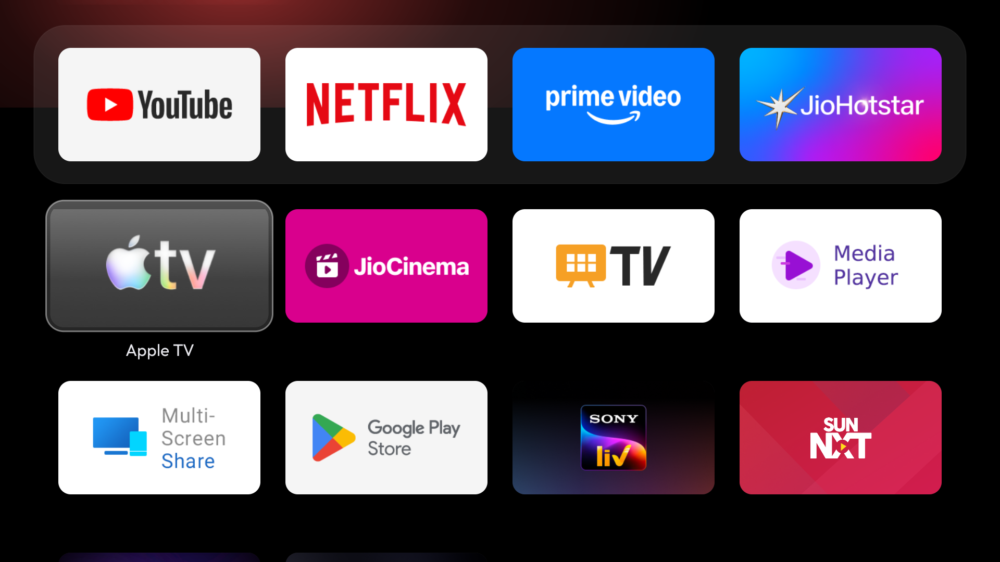
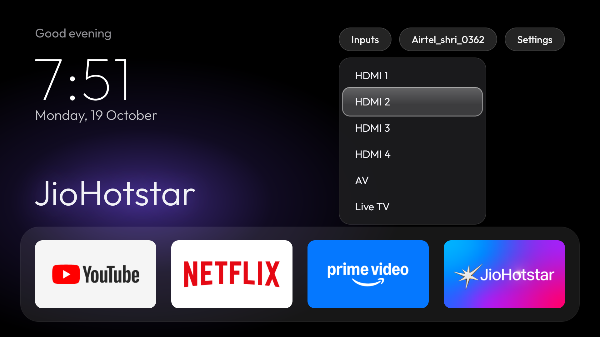

# ATV Home — debloat + Apple TV style launcher for Android TV

A tiny native Android TV launcher (one Java file, AndroidX RecyclerView, ~66 MB RAM) plus ADB scripts to debloat
the stock firmware. Built and tested on a **Changhong AI PONT** (MediaTek, Android TV 11, ~1.8 GB RAM, 1080p).

| Home | App grid | Inputs |
|---|---|---|
|  |  |  |

## Setup

1. On the TV: Settings → Device Preferences → About → press *Build* 7×, then Developer options → enable USB / network debugging.
2. On the Mac:
   ```
   python3 -m venv .venv && .venv/bin/pip install adb-shell
   export TV_IP=192.168.x.x        # your TV's address
   ./tv sh "getprop ro.product.model"   # first run: accept "Allow USB debugging?" on the TV
   ```
   `./tv` is a small Python `adb-shell` client — macOS Local Network privacy often blocks the stock `adb` binary.
3. `./install.sh` builds the launcher, installs it and makes it the default home
   (needs JDK 17+, Gradle, and the Android SDK at `~/Library/Android/sdk`).
   Then disable the stock launcher: `./disable.sh launcher com.google.android.tvlauncher`.

```
./tv sh "<shell command>"     run a command on the TV
./tv shot shots/x.png          screenshot
./tv key KEYCODE_HOME ...      press remote keys
./tv push <local> <remote>     copy a file (base64 chunks, md5-checked)
```

## Files

| file | what |
|---|---|
| `backup/` | (not committed) package lists, getprop, all settings — take one before changing anything |
| `disabled_by_us.txt` | every package this project disabled (restore.sh reads it) |
| `restore.sh` | re-enables everything in that list and makes the stock launcher home again |
| `install.sh` | builds the launcher, installs it, grants the Wi-Fi-name permission, makes it home |
| `disable.sh` | `./disable.sh <batch> pkg...` — disables, logs, screenshots |
| `launcher/` | launcher source (one Java file: `launcher/src/main/java/dev/atvhome/MainActivity.java`) |

## What was disabled (never uninstalled)

- Telemetry / retail: `com.google.android.feedback`, `com.homwee.store`
- Content & ads: `com.homwee.aipont` (AI PONT rows), `com.google.android.tvrecommendations`, `android.autoinstalls.config.homwee` (Play auto-install)
- Background: `com.homwee.chtvmanager` (cleaner), `com.google.android.backdrop` (Ambient mode), `com.homwee.upgrade` (Changhong app updater)
- Preloaded: `com.homwee.help`, `com.google.android.play.games`
- Your choice: `com.google.android.katniss` (Google Assistant), `com.homwee.alexacontrol`, `com.google.android.youtube.tvmusic`, `com.google.android.videos`
- Stock launcher: `com.google.android.tvlauncher`, `com.google.android.leanbacklauncher.partnercustomizer`

Kept on purpose: Live TV + TV input services, remote pairing (`com.mediatek.autopair`, `com.google.android.tv.remote.service`),
Bluetooth, keyboard, Play Store/Services, Chromecast, Miracast/AirPlay/Multi-Screen Share, Media Player, firmware updates
(`com.homwee.dmt.upgrade`), and `com.homwee.synckey` (system-level service whose job is unclear — left alone).

## Re-enable an app

```
./tv sh "pm enable --user 0 com.google.android.katniss"
```
Everything at once: `./restore.sh` (also puts the stock launcher back as home).
If the TV has no network ADB at the time, Settings → Apps → See all apps → Show system apps → pick the app → Enable.

## Change the dock

Without rebuilding — write one package name per line (left to right, max 4) to the launcher's folder on the TV:

```
printf 'com.netflix.ninja\ncom.google.android.youtube.tv\nin.startv.hotstar\ncom.amazon.amazonvideo.livingroom\n' > dock.txt
./tv push dock.txt /sdcard/Android/data/dev.atvhome/files/dock.txt
./tv sh "am force-stop dev.atvhome"; ./tv key KEYCODE_HOME
```
Package names: `./tv sh "pm list packages"`. To change the built-in default instead, edit `DOCK` at the top of
`MainActivity.java` and run `./install.sh`. Delete `dock.txt` to go back to the default.

## Change the wallpaper

Default is pitch black. For an image (JPEG, ideally 1920×1080; it's dimmed 40% so text stays readable):
```
./tv push my.jpg /sdcard/Android/data/dev.atvhome/files/wallpaper.jpg
./tv sh "am force-stop dev.atvhome"; ./tv key KEYCODE_HOME
```
Remove it with `./tv sh "rm /sdcard/Android/data/dev.atvhome/files/wallpaper.jpg"` and the same force-stop.

## Rebuild / reinstall the launcher

`./install.sh` (needs Homebrew `openjdk@21`, Gradle, and the Android SDK in `~/Library/Android/sdk`).

## Launcher notes

- Remote: arrows move one tile/row at a time; Up from the dock → top bar; Back in the grid → dock.
- Inputs pill → HDMI 1–4, AV, Live TV, switched through the TV input framework.
- The Wi-Fi pill needs location permission (Android only exposes the network name to apps that hold it); `install.sh` grants it.
- Clock, network and app list update from system broadcasts; nothing polls. ~66 MB RAM.
- Font: Outfit (SIL Open Font License, `launcher/src/main/assets/Outfit-OFL.txt`).

## When you're done

Turn **USB debugging / network debugging off**: Settings → Device Preferences → Developer options.
Turn it back on only when you want to run these scripts again.

## License

MIT — see `LICENSE`. The bundled Outfit font is under the SIL Open Font License (`launcher/src/main/assets/Outfit-OFL.txt`).
